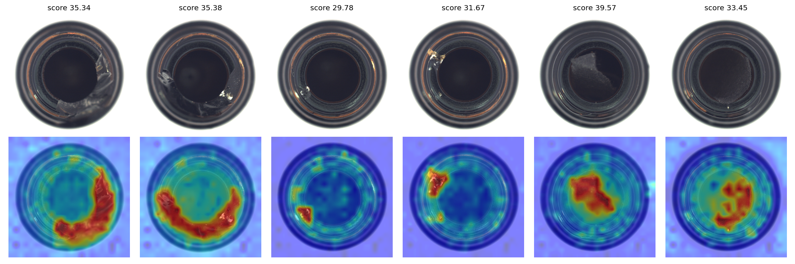
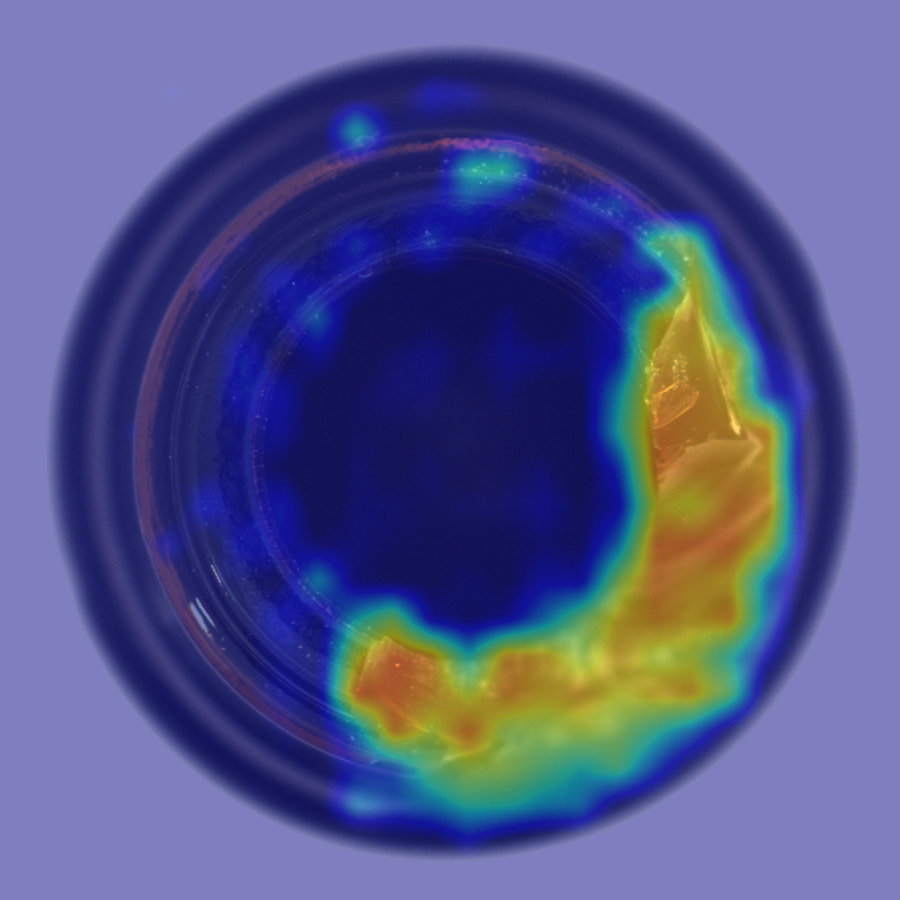

# Product Defect Detection with DINOv2 + FastAPI

Unsupervised anomaly detection for product images. The model is built from
**normal images only**, so it can flag defect types it has never seen.

## Method
- Backbone: DINOv2 ViT-S/14 (frozen, pretrained Vision Transformer)
- Memory bank of 60,000 patch embeddings from normal images (PatchCore-style)
- Anomaly score = distance from each patch to its nearest normal patch
- Output: image-level score, defect decision, and a pixel-level heatmap

## Results (MVTec AD, "bottle" category)
| Metric | Score |
|---|---|
| Image AUROC | 1.000 |
| Pixel AUROC | 0.990 |

Memory bank built from 189 normal training images; 20 more normal images
were held out to set the decision threshold. No defective images were used
for training. Evaluated on the 83 MVTec bottle test images (normal plus
broken_large, broken_small and contamination). Pixel AUROC is computed on a
subsample of pixels.



Example API output (heatmap overlay):



## API
```
pip install -r requirements.txt
uvicorn app:app --port 8000
```
```
curl -X POST -F "file=@bottle.png" http://127.0.0.1:8000/predict
```
Returns `anomaly_score`, `threshold`, `is_defect` and a base64 heatmap PNG.
Interactive docs are available at `/docs`. `app.py` expects
`patchcore_dino.pt`, which the notebook generates.

## Run it
Open the notebook in Google Colab (T4 GPU) and run all cells. It downloads
the dataset, builds the memory bank, evaluates, and writes `app.py` and
`patchcore_dino.pt`.

## Limitations
- Evaluated on one MVTec category so far; other categories may score lower.
- The threshold is set from only 20 normal images and should be tuned per
  product on real data.
- Lighting or viewpoint changes that never appear in the normal images can
  cause false alarms, so normal samples should cover the expected
  conditions.

## Dataset
MVTec AD (CC BY-NC-SA 4.0, non-commercial), loaded from a Hugging Face mirror.
